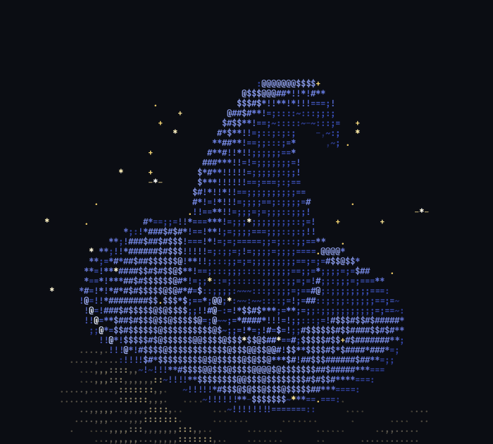

# spinning-ascii

Spinning 3D objects, rendered live as ASCII art in your terminal.

Each spinner is a single C file that needs only the C standard library and
`libm`. It models a real object, lights it, and draws it frame by frame
as coloured text.

<p align="center">
  
</p>

## The collection

| Spinner | What it is |
|---|---|
| [**wizard-hat**](wizard-hat/) | A floppy velvet wizard hat whose tip curls over and sways, with a pleated band and knot, a satin-lined brim, sparkles, and real shadows. Rebuilt in 3D from a photo. |

More are on the way.

## Quick start

```sh
git clone https://github.com/Snyder-linux/spinning-ascii.git
cd spinning-ascii
make                     # builds every spinner
./wizard-hat/hat3d       # q to quit
```

You need a C compiler (gcc or clang) and a terminal with 24-bit colour,
which almost every modern terminal has (kitty, Alacritty, foot, Ghostty,
WezTerm, iTerm2, GNOME Terminal, Windows Terminal). If yours doesn't, add
`--mono` to any spinner.

A bigger terminal window gives a bigger, more detailed picture.

## How the spinners work

All the spinners follow the same approach:

- **Shading ramp.** Brightness is drawn with `.,-~:;=!*#$@`, from dim to
  bright. Colour is added on top with 24-bit ANSI codes.
- **Tall cells.** Terminal character cells are about twice as tall as they
  are wide. Every projection scales vertically by ½ so shapes don't stretch.
- **Real 3D.** Objects are surfaces in 3D space. They're rotated, projected
  with perspective, and depth-buffered per character cell, so near parts
  hide far ones correctly.
- **One write per frame.** Each frame is built in memory and sent to the
  terminal in a single write on the alternate screen, which avoids flicker.
  The terminal is always restored on exit.

## Adding a spinner

New spinners are welcome. To keep the collection consistent, each one should:

1. Live in its own folder, `name/`, as a single C11 file using only the C
   standard library and `libm`. The top-level `make` builds any `*/*.c`
   automatically.
2. Accept `--frames N`, `--size WxH`, `--fps N` and `--mono`.
3. Print plain frames when stdout isn't a terminal, with rows ending in
   `\r\n` and no cursor movement. That lets
   [`tools/ansi2gif.py`](tools/ansi2gif.py) turn its output into a GIF:
   ```sh
   ./name/name --frames 96 --size 100x45 --fps 16 \
       | tools/ansi2gif.py --size 100x45 --fps 16 -o name/name.gif
   ```
   This needs Python 3 and ImageMagick with SVG support.
4. Quit cleanly on `q` and Ctrl-C, leaving the terminal as it found it.
5. Come with a `README.md` and a GIF, plus a row in the table above.

## License

[MIT](LICENSE)
