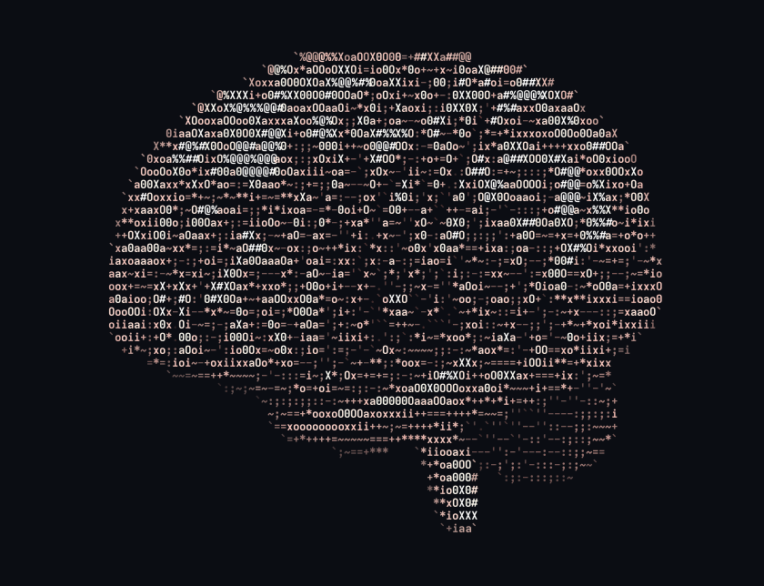
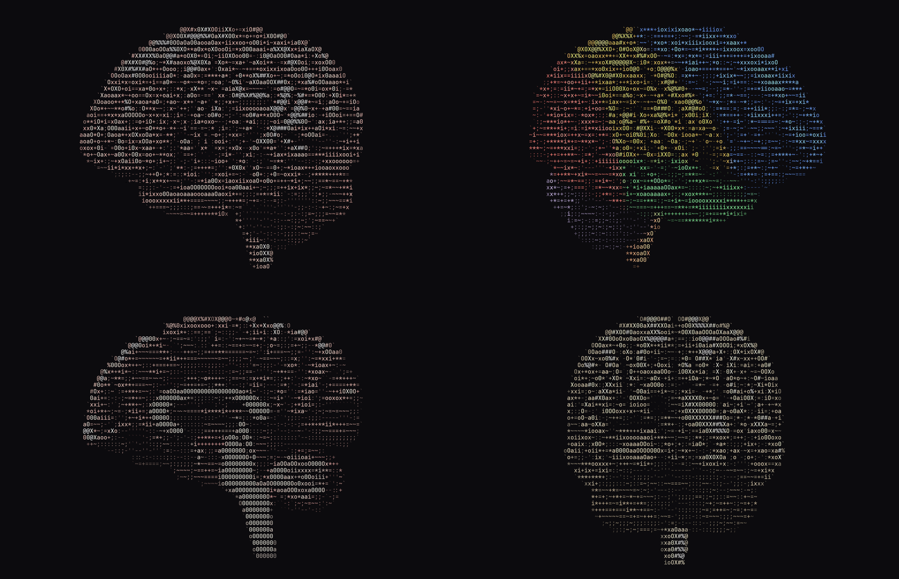
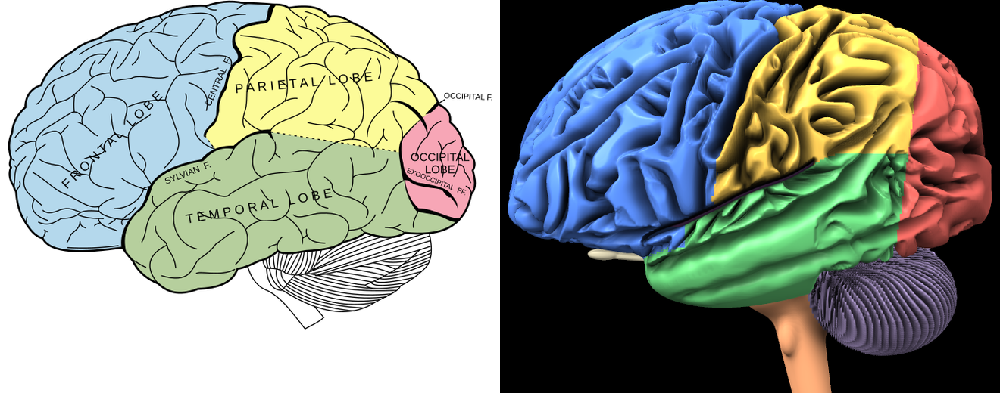

# Brain

A human brain built from anatomy references and spun as shaded ASCII art.
The cortex has 22 named sulci and folded gyri, and underneath are the
cerebellum, brainstem, cranial nerves and deep structures, which the
cut-away views reveal.

<p align="center">
  
</p>

## Run it

```sh
cc -O2 -pthread -o brain3d brain3d.c -lm     # or `make` from the repo root
./brain3d
./brain3d --material lobes                   # textbook lobe colours
./brain3d --cut sagittal                     # corpus callosum, arbor vitae
```

It fills the terminal and resizes with it. It's the most detailed spinner
here, so give it a big window and a small font: at 500×125 characters a
frame takes about 29 ms on 16 cores. Unlike the others it uses threads
(`-pthread`), because every core helps render each frame.

| Key | Action |
|---|---|
| <kbd>←</kbd> <kbd>→</kbd> | Spin slower or faster (or backwards) |
| <kbd>↑</kbd> <kbd>↓</kbd> | Tilt the camera |
| <kbd>+</kbd> <kbd>-</kbd> | Zoom |
| <kbd>m</kbd> | Material: fresh → formalin-fixed → lobes atlas → MRI surface |
| <kbd>x</kbd> | Cut-away: coronal → axial → midsagittal → none |
| <kbd>h</kbd> <kbd>a</kbd> <kbd>c</kbd> | Turn soft shadows, "activity" waves, colour on or off |
| <kbd>Space</kbd> | Pause |
| <kbd>r</kbd> | Reset the view |
| <kbd>q</kbd> / <kbd>Esc</kbd> / <kbd>Ctrl</kbd>+<kbd>C</kbd> | Quit |

The status bar names the face you're looking at and the structure under
the centre of the screen, for example `left lateral | centre: temporal lobe`.

| Option | Effect |
|---|---|
| `--mono` | No colour |
| `--size WxH` | Fixed size instead of the terminal's |
| `--material M` | `fresh`, `fixed`, `lobes` or `mri` |
| `--cut C` | `none`, `coronal`, `axial` or `sagittal` |
| `--spin R` | Spin speed in radians per second (default 0.45) |
| `--yaw DEG`, `--pitch DEG`, `--at T` | Start at a given angle, tilt or animation time |
| `--frames N` | Render N frames, then exit |
| `--fps N` | Target frame rate (default 30) |
| `--aa N` | Rays per cell along each axis, 1–3 (default 3) |
| `--res MM` | Voxel size (default 0.8 mm; smaller is finer but slower to start) |
| `--threads N` | Worker threads (default: every core) |
| `--no-shadows`, `--activity` | Leave out shadows, or start with activity waves on |
| `--ppm FILE` | Render one square-pixel image of `--size` pixels and exit |

<p align="center">
  
</p>

## How it's made

### The model

The brain is sculpted in millimetres in Talairach-style coordinates
(x = right, y = front, z = up) as *signed distance fields*:

- **Hemispheres.** One dome split down the middle by the longitudinal
  fissure, so each hemisphere's highest point sits next to the midline, as
  in real coronal sections. The frontal pole bulges forward over a low,
  flat orbital surface.
- **Named sulci.** Twenty-two sulci are placed from atlas coordinates,
  including the central sulcus with its hand knob, the Sylvian fissure with
  its rami, and the calcarine, cingulate and intraparietal sulci. Each groove
  cuts in perpendicular to the surface, with rounded lips.
- **Folds between them.** The zero-contour of warped noise gives
  labyrinthine gyri about a centimetre wide. They're stretched front to back
  in the frontal and temporal lobes and top to bottom beside the central
  sulcus, because that's how those gyri run.
- **Cerebellum.** Thin folia fan out from the peduncles. Ten regularly
  spaced lobular fissures run in close to the core, so a midsagittal cut
  shows the branching white *arbor vitae*.
- **Inside.** A grey cortical ribbon over white matter, corpus callosum,
  thalami, basal ganglia, hippocampus, the ventricles, brainstem with olives,
  and the optic, olfactory, trigeminal and oculomotor nerves.

### Each frame

1. **Sculpt once.** At start-up every core samples the model into a
   191×243×218 volume of 0.8 mm voxels, about 10 million, in roughly a second.
   Each voxel also stores a tissue or lobe label and its depth below the
   unfolded outer surface.
2. **March.** Each character cell fires 3×4 rays, which step through the
   volume until they hit the surface.
3. **Light.** Wrap-around diffuse light for soft tissue, soft shadows from a
   key light, ambient occlusion at two scales so deep sulci go dark, a wet
   highlight, a rim light, and a little red light scattering through the
   tissue.
4. **Output.** Auto-exposure maps gyral crowns to dense glyphs (`#%@`) and
   sulci to sparse ones (`.'-`), coloured with 24-bit ANSI codes and written
   in one go.

## References, and what each one changed

- **Size:** Chudler's *Brain Facts and Figures* and the Talairach &
  Tournoux (1988) atlas. Each hemisphere is 179 mm long and 113 mm high,
  with the frontal pole at y = +73 mm (the atlas puts it at about +70).
- **Profile:** Gray's *Anatomy* (1918), fig. 728. Compared side by side at
  matched length, the first version's frontal lobe was a near-vertical wall
  over a rising floor. The fix gave it a forward bulge, a sloping crown and
  a low orbital edge, plus a steeper Sylvian fissure and a smaller occipital
  lobe. The length-to-height ratio is now 1.59, against about 1.6 in the
  plate.

  

- **Landmarks:** Purves' *Neuroscience* lab guide and MRI studies of the
  central sulcus. The central sulcus runs down and forward with a "lazy S"
  and a hand knob, and stops short of the Sylvian fissure, as it does in 68
  of 82 hemispheres in one study. It meets the top 62 % of the way back,
  matching the Talairach atlas.
- **Folding:** the gyrification index and a 2–4 mm cortical thickness.
  With only the named sulci carved, the first render looked like grooves
  engraved on an egg, so a second layer of folds was added.
- **Asymmetry:** Yakovlevian torque and Geschwind & Levitsky (1968). The
  right frontal lobe sticks out about 3 mm further, the left occipital lobe
  about 4 mm further back, and the left Sylvian fissure is longer and
  flatter (about 24° against 29° on the right).
- **Cerebellum:** Sereno et al. (2020) and Herculano-Houzel. It holds about
  80 % of the brain's neurons in very fine folds, so it gets its own folia
  instead of the cerebral folds.
- **Colour:** living brain is pinkish-grey from the blood in its surface
  vessels, and formalin turns it beige-grey, hence the material modes.

This is an anatomically informed sculpture, not scan data. The named sulci
follow atlas positions, but the folds between them are procedural and only
statistically like a real cortex.

## Rebuilding the GIF

```sh
./brain3d --frames 72 --size 120x46 --fps 12 --spin 1.0472 \
    | ../tools/ansi2gif.py --size 120x46 --fps 12 -o brain.gif
```

`--spin 1.0472` makes 72 frames at 12 fps add up to one full turn.
