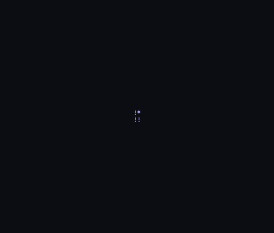
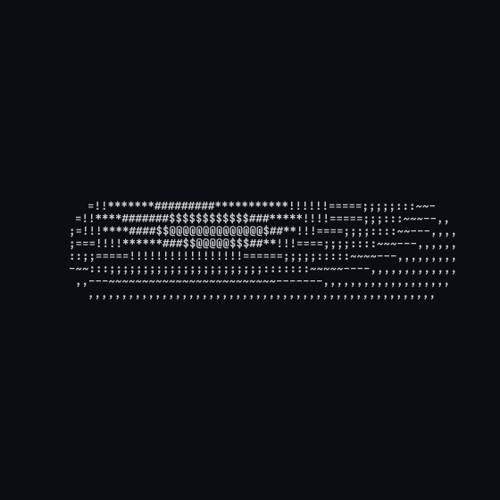

# Small spinners

Small, classic tumbling shapes in the spirit of `donut.c`. Each is one short
C file.

| `spin.c` | `morph.c` |
|---|---|
|  |  |

## Run them

```sh
cc -O2 -o spin spin.c -lm       # or `make` from the repo root
cc -O2 -o morph morph.c -lm
./spin
./morph
```

Both fill the terminal and quit on <kbd>q</kbd>, <kbd>Esc</kbd> or
<kbd>Ctrl</kbd>+<kbd>C</kbd>. Both take `--size WxH`, `--frames N` and
`--fps N`.

## spin.c

Five scenes, 12 seconds each, each in its own colour:

| Scene | Colour |
|---|---|
| A trefoil knot | purple |
| A twisted ribbon (a Möbius-like band) | orange |
| A spiral seashell | gold |
| A rippling blob | white |
| Triangle-faced solids morphing into each other: tetrahedron, triangular bipyramid, octahedron, icosahedron | ice |

Each shape shrinks away and grows back between scenes.

| Option | Effect |
|---|---|
| `white`, `purple`, `orange`, `gold`, `ice`, `ember` | Use one colour for every scene |
| `--mono` | No colour |

**How it works.** The knot, ribbon, shell and blob are parametric surfaces:
functions `(u, v) → point` sampled densely enough to cover every character
cell, with a surface direction at each point. The points are rotated on
three axes, projected with perspective and depth-buffered per cell, as in
`donut.c`. The blob is rebuilt every frame as it ripples. The triangle
solids are different: each is the intersection of its face planes, and the
morph blends two of those distance functions, so they're drawn by marching
a ray through every cell instead. Everything is shaded by a key and a fill
light and coloured from 256-colour palettes.

## morph.c

One surface that flows from a torus to a twisted rounded cube, to a twisted
octahedron, to a rippling sphere and back, pausing on each form while it
tumbles on two axes. It's plain monochrome text (`--mono` is accepted and
changes nothing). `./morph 3.0` prints the frame at time 3.0 and exits.

**How it works.** Each form is a signed distance function, and the scene is
a smooth blend from one to the next. Morphed distances aren't exact, so the
ray marcher takes shorter steps. Normals come from the field's gradient;
the light gives a diffuse term plus a specular glint.

## Rebuilding the GIFs

```sh
./spin --frames 480 --size 80x34 --fps 8 \
    | ../tools/ansi2gif.py --size 80x34 --fps 8 -o spin.gif
./morph --frames 202 --size 80x40 --fps 10 \
    | ../tools/ansi2gif.py --size 80x40 --fps 10 -o morph.gif
```

The spin GIF covers all five scenes. The morph GIF covers one full cycle of
the four forms.
