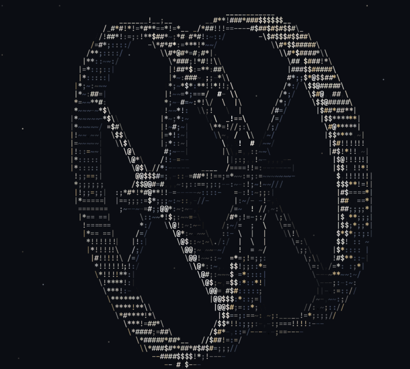

# Space station

The double-wheel space station from *2001: A Space Odyssey*, spinning slowly
among the stars as shaded ASCII art. It's a fan rendering built from simple
shapes, not a copy of the studio model.

<p align="center">
  
</p>

## Run it

```sh
cc -O2 -o station station.c -lm     # or `make` from the repo root
./station
```

It fills the terminal and resizes with it. A smaller terminal font gives a
sharper station: below about 0.1 world units per column the panel joints,
spoke rails and lattice beams switch on.

| Key | Action |
|---|---|
| <kbd>q</kbd> / <kbd>Esc</kbd> / <kbd>Ctrl</kbd>+<kbd>C</kbd> | Quit |

| Option | Effect |
|---|---|
| `--mono` (or `mono`) | No colour |
| `white`, `purple`, `orange`, `gold`, `ice`, `ember` | One 256-colour palette instead of full colour |
| `--size WxH` | Fixed size instead of the terminal's |
| `--frames N` | Render N frames, then exit |
| `--fps N` | Target frame rate (default 30) |
| `--at T` | Start at time T seconds |
| `--no-stars`, `--no-edges` | Leave out the starfield or the line-drawn silhouettes |
| `T [COLS ROWS]` | Print the single frame at time T and exit |
| `--bench [COLS ROWS]` | Time 120 frames (default 200×60) |

## How it's made

### The model

The station is about 21 units across, with the spin axis along X.

- **The finished wheel.** A wide rim with rounded corners, panel joints every
  1.3 units and a seam along each side. Rows of windows run along the outer
  face and both sides; most are lit and glow warm on the dark side.
- **The wheel under construction.** Mostly skinned like the finished one, but
  one arc is an open lattice of beams and the next is bare C-shaped ribs with
  stringers, as if the skin hasn't been fitted yet.
- **Spokes.** Four per wheel, each with housings where it meets the hub and
  the rim, plus rails and ties along its length.
- **Hub and axle.** A hub module at each wheel, a bearing between the wheels,
  a tail stub at the back, and a tapered docking port at the front with a
  slot in its face.

Every part is a *signed distance field*: a function that gives the distance
from any point to the part's surface. The whole station is the closest of
them, and each part is skipped while a cheap bounding shape says it's far
away.

### Each frame

1. **March.** One ray per character cell steps toward the station by the
   distance field until it touches a surface. A box around the station
   skips the empty space.
2. **Light.** Each hit is lit by a warm sun from the upper left and a cool
   fill light from below. Soft shadows are marched toward the sun, so the
   spokes and the near wheel shade the rest. Ambient occlusion darkens
   creases and the lattice, and shiny parts get a highlight. Far parts are
   dimmed slightly for depth.
3. **Antialias.** Cells on the silhouette, on a change of material, or at a
   jump in depth get four more rays. Their coverage softens edges, and where
   the edge has a clear direction the cell is drawn as `/ \ | _ -` so thin
   parts stay visible.
4. **Level of detail.** Detail smaller than a character only adds noise, so
   it's dropped on coarse grids, while windows and lattice grow to stay one
   clean character each.
5. **Output.** The station spins once every 24 seconds while the view sways
   slowly over 80 seconds. Empty cells get twinkling stars. The frame is
   written in one go on the terminal's alternate screen, placing each row
   with a cursor move so the terminal can never scroll.

A frame takes about 10 ms at 100×45 characters on a desktop.

## Rebuilding the GIF

```sh
./station --at 8 --frames 96 --size 100x45 --fps 4 \
    | ../tools/ansi2gif.py --size 100x45 --fps 12 -o space-station.gif
```

Rendering at `--fps 4` and playing back at 12 fps makes 96 frames cover one
full 24-second turn, three times faster than live. Starting at 8 seconds
puts the view's sway at the same angle on the first and last frames, so the
loop has no jump.
