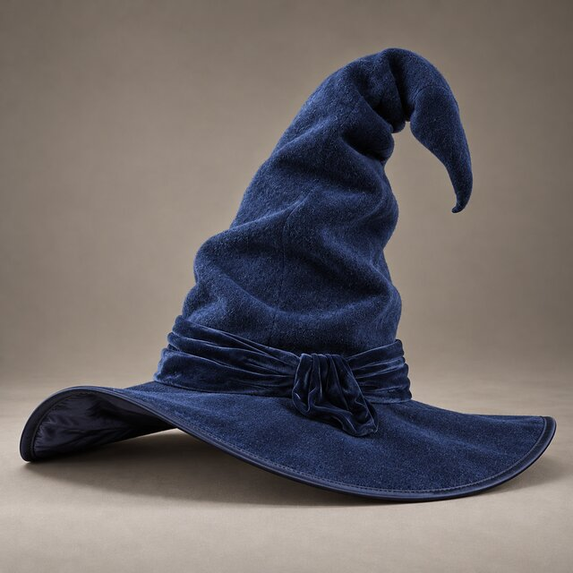
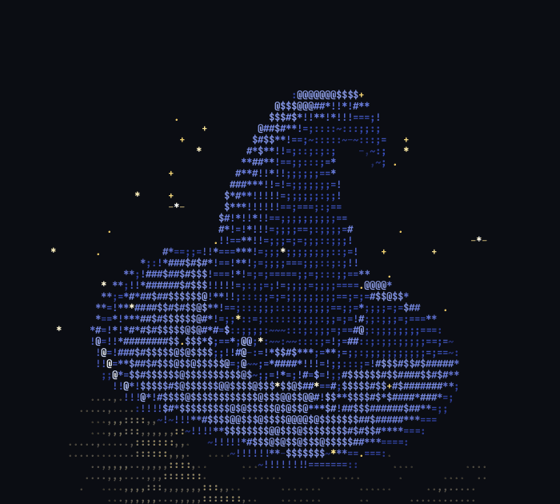

# Wizard hat

A floppy velvet wizard hat, rebuilt in 3D from a photo and rendered live as
ASCII art.

| Reference photo | In your terminal |
|---|---|
|  |  |

## Run it

```sh
cc -O2 -o hat3d hat3d.c -lm     # or `make` from the repo root
./hat3d
```

It fills the terminal and resizes with it.

| Key | Action |
|---|---|
| <kbd>←</kbd> <kbd>→</kbd> | Spin slower or faster (or backwards) |
| <kbd>↑</kbd> <kbd>↓</kbd> | Tilt the camera |
| <kbd>+</kbd> <kbd>-</kbd> | Zoom |
| <kbd>Space</kbd> | Pause |
| <kbd>c</kbd> <kbd>s</kbd> <kbd>f</kbd> <kbd>w</kbd> | Turn colour, sparkles, floor, wobble on or off |
| <kbd>r</kbd> | Reset the view |
| <kbd>q</kbd> / <kbd>Esc</kbd> | Quit |

| Option | Effect |
|---|---|
| `--mono` | No colour |
| `--size WxH` | Fixed size instead of the terminal's |
| `--spin R` | Spin speed in radians per second (default 0.8) |
| `--yaw DEG`, `--at T` | Start at a given angle or animation time |
| `--frames N` | Render N frames, then exit |
| `--fps N` | Target frame rate (default 30) |
| `--no-floor`, `--no-sparkles`, `--no-wobble` | Leave those out |

## How it's made

### The model

The hat is built from six parametric surfaces, each a function
`(u, v) → point`:

- **Crown.** A cone that sags into a sack shape, then tapers. Its centre line
  is made by stepping along a bending angle: straight at the base, then
  curling over and down at the tip. The angle changes over time, so the tip
  sways. The cross-section follows the curve using a *parallel-transport*
  frame, which keeps the tube from twisting. Layered sine waves add crumpled
  folds that shift slowly.
- **Band.** A velvet sleeve with horizontal pleats. Near the knot it narrows
  and its pleats deepen, as if the fabric is gathered there.
- **Knot and tail.** A lumpy velvet blob, plus a ribbon that leaves the knot
  and settles onto the brim, following its height.
- **Brim.** A slightly oval sheet that lifts at the back-left and droops at
  the front-right, and flutters over time. The top is felt; the underside is
  shiny satin.
- **Piping.** A thin satin tube that follows the brim's edge.

### Each frame

1. **Sample.** Every surface is sampled on a grid sized to the terminal, and
   each point's surface direction is worked out from its grid neighbours.
   That's about 100,000 points per frame.
2. **Shadows.** The points are drawn into a *shadow map* from the main light,
   which records what the light can see. That's how the crown shades the
   brim and the hat casts a shadow on the floor. Soft edges come from
   sampling 3×3 neighbours.
3. **Shade.** Each point is lit by three lights: a main light, a fill light
   and a back light. Shiny highlights are added on the satin, and a soft
   glow on velvet edges seen at a grazing angle. A little noise mimics the
   fabric texture.
4. **Project.** Points are projected with perspective, at half height for the
   tall character cells. A per-cell depth buffer keeps whichever point is
   nearest.
5. **Floor.** The checkered floor is found by casting a ray through each
   empty cell. It uses the same shadow map, so it shows the hat's shadow.
6. **Sparkles.** Gold sparkles rise in spirals around the hat and pass
   behind it correctly.
7. **Output.** The frame is sent to the terminal as 24-bit colour text in a
   single write.

On a desktop, a frame takes about 8 ms at 100×45 characters and 29 ms at
300×90, so it holds 30 fps even in a large terminal window.

## Bonus: `ascii_rot.c`

`ascii_rot.c` is a simpler companion that works straight from a photo
instead of a 3D model. It removes the backdrop, then rotates the cut-out as
ASCII:

```sh
cc -O2 -o ascii_rot ascii_rot.c -lm
./ascii_rot reference.jpg 30 80          # rotated 30°, 80 characters wide
./ascii_rot reference.jpg 0 100 --spin   # spinning in place
./ascii_rot reference.jpg 0 100 --turntable
```

It needs ImageMagick (`magick`) at runtime to read the image.

## Rebuilding the GIF

```sh
./hat3d --frames 96 --size 80x36 --fps 16 --spin 1.0472 \
    | ../tools/ansi2gif.py --size 80x36 --fps 16 -o wizard-hat.gif
```

`--spin 1.0472` makes 96 frames at 16 fps add up to one full turn.
